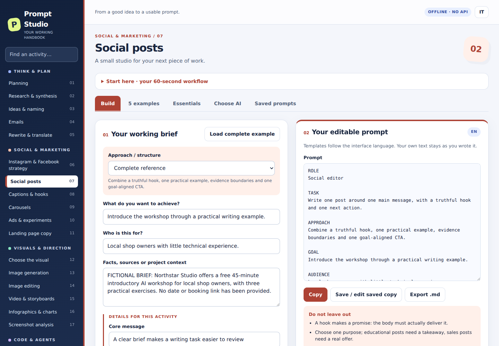

# Prompt Studio

Un laboratorio interattivo per costruire prompt: **22 attività, 110 esempi, italiano e inglese**. Funziona nel browser senza installazione, chiavi API o backend.

## Apri il prodotto

Per usare l’app apri il **sito GitHub Pages**, non l’anteprima del codice HTML su GitHub.
Il proprietario deve completare una sola volta [le istruzioni di pubblicazione](PUBBLICAZIONE-IT.md).
Dopo l’attivazione, il link sarà `https://TUO-USERNAME.github.io/prompt-studio/`.
Il proprietario può sostituire questa riga con il proprio link e aggiungerlo al campo **Website** nella sezione **About** della repository.

## Come funziona

1. Scegli un’attività e carica un esempio completo.
2. Personalizza obiettivo, pubblico, contesto e vincoli.
3. Copia il prompt nello strumento AI scelto e allega lì gli eventuali file.
4. Controlla il risultato, salva il prompt nel tuo browser ed esporta un backup JSON.

L’app compone prompt; non esegue modelli AI. Le indicazioni sui servizi AI sono una fotografia delle fonti al **8 ottobre 2026** e non si aggiornano automaticamente.

## Versione pubblicata e raccolta personale

Compilare i campi, modificare un prompt, importare un backup o cancellare un salvataggio cambia solo la propria sessione o raccolta locale. Queste azioni non modificano la repository o il sito condiviso. I salvataggi non sono sincronizzati tra dispositivi e possono scomparire cancellando i dati del browser. Se usavi l’HTML scaricato, esporta da quel file un backup JSON e importalo nel sito per trasferire la raccolta.

Solo il proprietario e chi riceve permessi di scrittura possono aggiornare la repository. Una repository pubblica rende il codice visibile e copiabile: una copia o un fork non modifica questo prodotto pubblicato.

## Materiale

- [Handbook in inglese (PDF)](docs/Prompt-Studio-Handbook-EN.pdf)
- [Anteprima della scelta degli strumenti AI](assets/preview-ai.png)
- [Guida di pubblicazione in italiano](PUBBLICAZIONE-IT.md)

## Avvio locale

Apri `index.html` in un browser moderno. Per riprodurre l’utilizzo via HTTP puoi anche eseguire `python3 -m http.server 8000` nella cartella e aprire `http://localhost:8000/`.
